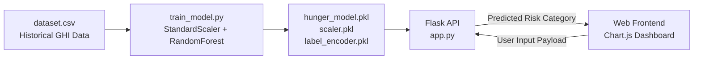

# 🌍 Global Hunger Risk Predictor

> **AI-Driven Global Hunger Index (GHI) Severity Classification & Trend Visualization Platform**

[](https://python.org/)
[](https://flask.palletsprojects.com/)
[](https://scikit-learn.org/)
[](https://www.chartjs.org/)
[](LICENSE)

---

## 📌 Overview

The **Global Hunger Risk Predictor** is a machine learning-backed web platform designed to analyze historical multi-year hunger index metrics and predict future food insecurity risk levels across nations.

Utilizing longitudinal data spanning the years **2000, 2008, 2015, and 2023**, the model trains a **Random Forest Classifier** to categorize countries into standardized food security risk levels (`Low`, `Moderate`, `Serious`, `Alarming`, `Extremely Alarming`). The web dashboard provides dynamic input forms, historical trend line charts using **Chart.js**, and instant risk classification.

---

## 🏗️ Architecture & Workflow



---

## 🚀 Key Features

- **Trained Machine Learning Model:** Pre-trained Random Forest ensemble model (`100 estimators`) trained on normalized multi-decade GHI indices.
- **Interactive Visual Analytics:** Integrated **Chart.js** line graph plotting the country's progression across milestone years (2000 ➔ 2008 ➔ 2015 ➔ 2023).
- **Fast RESTful Inference API:** Sub-millisecond predictions served via a lightweight Flask backend.
- **Robust Feature Preprocessing:** Zero-mean, unit-variance feature scaling via `StandardScaler` with automatic inverse label mapping via `LabelEncoder`.

---

## 📂 Project Structure

```
hunger_project/
├── static/
│   ├── script.js             # Client-side validation, Chart.js rendering & API fetch
│   └── style.css              # Modern UI stylesheet
├── templates/
│   └── index.html            # Responsive prediction dashboard layout
├── dataset.csv               # Historical Global Hunger Index dataset
├── train_model.py            # ML model training and artifact export script
├── app.py                    # Flask application serving UI and /predict API
├── hunger_model.pkl          # Serialized Random Forest Classifier
├── scaler.pkl                # Serialized StandardScaler
├── label_encoder.pkl         # Serialized LabelEncoder
├── .gitignore                # Git exclusions
└── README.md                 # Project documentation
```

---

## 🛠️ Tech Stack

- **Backend:** Python 3.10+, Flask
- **Machine Learning:** Scikit-Learn (RandomForestClassifier), Pandas, NumPy, Joblib
- **Frontend:** HTML5, CSS3, Modern JavaScript, Chart.js

---

## ⚡ Quick Start & Installation

### 1. Prerequisites
- Python 3.10 or higher
- `pip`

### 2. Setup Virtual Environment
```bash
# Clone the repository
git clone https://github.com/<your-username>/hunger_project.git
cd hunger_project

# Create and activate virtual environment
python -m venv venv
# Windows:
venv\Scripts\activate
# Linux/macOS:
source venv/bin/activate
```

### 3. Install Dependencies
```bash
pip install flask pandas numpy scikit-learn joblib
```

### 4. (Optional) Re-train the Machine Learning Model
To retrain the model and regenerate `.pkl` artifacts:
```bash
python train_model.py
```
*Output: `✅ All files saved successfully!`*

### 5. Start the Web Server
```bash
python app.py
```
Open `http://127.0.0.1:5000` in your web browser.

---

## 📡 API Reference

### Predict Hunger Risk
- **Endpoint:** `POST /predict`
- **Headers:** `Content-Type: application/json`
- **Request Body:**
  ```json
  {
    "country": "Sample Country",
    "rank": 75,
    "y2000": 32.5,
    "y2008": 28.1,
    "y2015": 22.4,
    "y2023": 18.2
  }
  ```
- **Response:**
  ```json
  {
    "prediction": "Moderate"
  }
  ```

---

## 📄 License

This project is open-source under the [MIT License](LICENSE).
